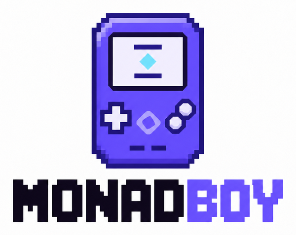
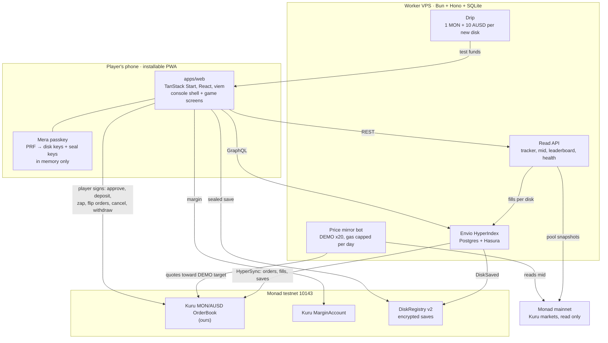
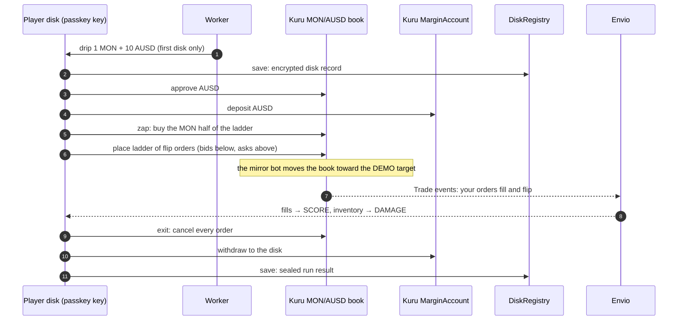
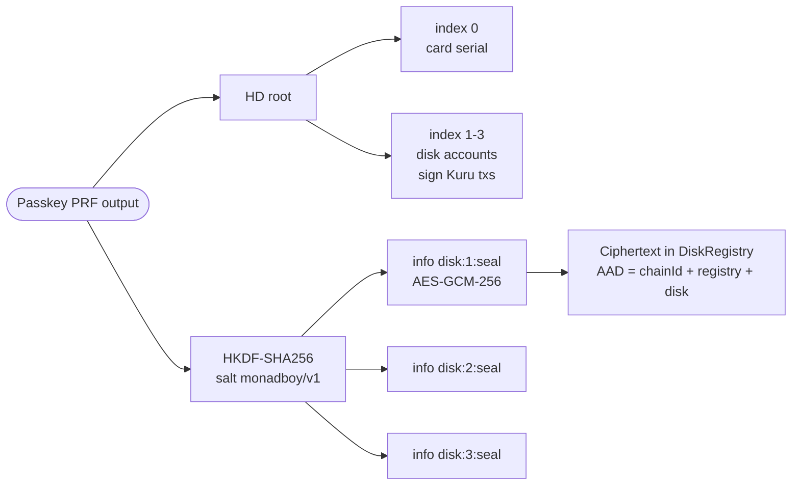

<p align="center">
  
</p>

<h3 align="center">Games taught us by letting us play. Why does DeFi start with homework?</h3>

<p align="center">
  MONADBOY is a handheld game console in your browser that teaches market making by doing it.<br />
  Set a price range and it becomes a <b>real ladder of Kuru flip orders on Monad TESTNET</b>.<br />
  Fills earn <b>SCORE</b>. Leaving your range costs <b>DAMAGE</b>. Both are always the same size on screen.
</p>

<p align="center">
  <a href="https://monadboy-play.vercel.app/play"><b>Play it live</b></a> ·
  <a href="#for-judges-try-it-in-5-minutes">Judge brief</a> ·
  <a href="#how-a-run-plays">How it plays</a> ·
  <a href="#architecture">Architecture</a> ·
  <a href="#sponsor-integrations">Sponsor integrations</a> ·
  <a href="#onchain-evidence">Onchain evidence</a> ·
  <a href="#roadmap">Roadmap</a>
</p>

<p align="center">
  
  
  
  
  
  
  
</p>

<p align="center">
  
  &nbsp;&nbsp;&nbsp;
  
  &nbsp;&nbsp;&nbsp;
  
</p>
<p align="center"><sub><b>MOLANDAK</b> plays EASY · <b>MOYAKI</b> plays NORMAL · <b>MOUCH</b> plays HARD. Pick your Monanimal, pick your risk.</sub></p>

---

## MONADBOY in numbers

Read from our Envio indexer and worker on Monad testnet, 12 October 2026. Almost all of this activity is ours (founder, early testers, test accounts and the price mirror bot), not organic users.

| | |
|---|---|
| **384** Kuru flip orders indexed | on our MON/AUSD TESTNET market |
| **139** maker fills indexed | each one a real Kuru `Trade` event, turned into SCORE |
| **11** save disks with encrypted saves onchain | AES-GCM ciphertext in `DiskRegistry`, keyed by the passkey |
| **6 transactions** | a full player round trip: approve, deposit, zap, place ladder, cancel, withdraw |
| **1 tap** | passkey sign-up. No wallet app, no seed phrase, no extension |
| **42 of 42** | worker health samples green over a 10 minute mirror run, zero errors |

## The problem

Liquidity is the most important job in any market, and almost nobody understands it.

People who swap without thinking freeze at "set your range". And the ones who jump in usually learn the hard way: across 17 large Uniswap v3 pools, liquidity providers earned **$199.3M in fees but lost $260.1M to impermanent loss**, leaving them **$60.8M worse off than if they had just held** ([Loesch et al., 2021](https://arxiv.org/abs/2111.09192)).

Three things make it hard to learn:

1. **The words are the wall.** Range, ladder, flip, inventory, impermanent loss. You need the vocabulary before you can try anything.
2. **The first lesson costs real money.** There is no safe place to make the mistake once and feel it.
3. **The risk is hidden.** Dashboards show the fees you earned in big green numbers and bury what the position lost.

## What MONADBOY does

Every handheld game we grew up with taught complicated systems without a manual. You pressed buttons, something happened, you got it. MONADBOY does that for market making.

| | Learning market making today | MONADBOY |
|---|---|---|
| How you start | Docs, threads, a wallet, a seed phrase | Insert a memory card (one passkey tap) and press START |
| What a range is | A formula | Ground your Monanimal walks on. Step off it and they sit down |
| What happens when price moves | Numbers change somewhere | Your orders fill, flip and pop on screen as they happen |
| How risk is shown | Fees big, losses small | **SCORE** and **DAMAGE** side by side, same size, always |
| What it costs to learn | Real money | **TESTNET only**: free test MON and AUSD, nothing real at risk |
| Are the orders real | Simulators fake the market | Real Kuru flip orders on Monad testnet, every one with a transaction link |

**Honest by design.** A testnet market has no natural price action. So a bot we run mirrors the live Kuru **mainnet** MON price onto our TESTNET market, with moves amplified 20x so a five minute session actually shows something. The app labels this `DEMO x20` everywhere and shows the raw mainnet price, the DEMO target and the actual TESTNET book side by side.

## How a run plays

```mermaid
flowchart LR
    A(["Open monadboy-play.vercel.app"]) --> B["INSERT CARD<br/>one passkey tap"]
    B --> C["Pick a SAVE DISK<br/>free TESTNET MON + AUSD"]
    C --> D["Pick a Monanimal<br/>EASY · NORMAL · HARD"]
    D --> E["Tracker<br/>real Kuru markets as a map<br/>find the PLAYABLE pin"]
    E --> F["Set Range<br/>how much, how wide"]
    F --> G["Confirm<br/>approve · deposit · zap · place ladder"]
    G --> H{"Price moves"}
    H -- "inside your range" --> I["Orders fill and flip<br/>SCORE goes up"]
    H -- "outside your range" --> J["Monanimal sits<br/>DAMAGE vs holding"]
    I --> K["B: exit<br/>cancel orders, withdraw"]
    J --> K
    K --> L["Results sealed to your disk<br/>Leaderboard"]
```



- **SCORE** is the realized spread from your flipped orders that actually filled, read from the indexer.
- **DAMAGE** is what your inventory lost against simply holding the same tokens.
- **NET** is SCORE minus DAMAGE. It can be negative, and the game says so.

## Architecture



**Rules that shaped it**

- **The player always signs.** The worker never holds a player key and never signs for a player. It funds new disks, serves reads and runs the mirror bot with its own keys.
- **Chain is truth.** Balances, orders, fills and saves are read from the chain. Envio and SQLite are read models.
- **Keys never leave memory.** PRF output and every derived key live only inside the card session. Ejecting the card or 10 minutes in the background clears them.
- **No hidden numbers.** Every value on screen has a source label: mainnet, DEMO target, TESTNET book, indexer or fallback.

| Path | What lives there |
|---|---|
| [`apps/web`](apps/web) | The console: landing, `/play` shell, game screens, chain execution, Mera card session, PWA |
| [`apps/worker`](apps/worker) | Bun + Hono worker: tracker snapshots, drip, mirror bot, leaderboard, health |
| [`packages/sdk`](packages/sdk) | Pure shared logic: Mera key derivation, disk sealing, range planner, units, ABIs |
| [`contracts`](contracts) | `DiskRegistry` (Foundry, with tests and gas snapshot) |
| [`indexer`](indexer) | Envio HyperIndex config, schema and handlers |
| [`deploy`](deploy) | VPS units, Caddy, compose, `demo-mode.sh`, operations runbook |
| [`docs`](docs) | [PRD](docs/PRD.md), [DESIGN-SYSTEM](docs/DESIGN-SYSTEM.md), [ARCHITECTURE](docs/technical/ARCHITECTURE.md), [SMART-CONTRACTS](docs/technical/SMART-CONTRACTS.md), [INTEGRATIONS](docs/technical/INTEGRATIONS.md), [BUILD-PLAN](docs/technical/BUILD-PLAN.md), [LESSONS](docs/LESSONS.md) |

## One run, onchain



## Why Monad

- **A fill should feel like a game tick.** With sub-second blocks a flip fill shows up while you are still looking at the screen, so the order book can be the game loop instead of a slow backend.
- **An onchain order book is the right shape for a game.** Kuru flip orders re-arm on the opposite side after they fill, so a ladder of them behaves like ground a character walks on. Every rung is a real resting order you can open in the explorer.
- **Honest gas.** Monad bills the declared gas limit, so every transaction carries an explicit, measured limit and the game checks that a disk can afford to **enter and exit** before it lets you start.
- **Passkeys as accounts.** Mera turns one passkey into ordinary Monad accounts, which makes the memory card metaphor literal.

## Sponsor integrations

### Kuru: the order book is the game board

Your range becomes a ladder of real **flip orders** on our Kuru MON/AUSD market on Monad testnet. Entry is approve, deposit into the Kuru `MarginAccount`, a zap that buys the MON side of the ladder from the book, then the ladder itself. When the price walks through a rung, it fills and flips to the other side, which is exactly what earns SCORE. Exit cancels every order and withdraws to your disk. Before anything is signed the game checks that the book has enough depth to fund the ladder and that your disk has gas to enter **and** exit, and it says plainly when either is not true.

The tracker reads real Kuru **mainnet** markets (read only) and draws them as a map of safety vs heat, so difficulty tiers mean something. Code: [`apps/web/src/chain/market-execution.ts`](apps/web/src/chain/market-execution.ts), [`packages/sdk`](packages/sdk), [`apps/worker/src/chain`](apps/worker/src/chain).

### Mera: the passkey is the memory card

Mera is the entire account layer. No seed phrase, no extension, no email, no custody backend. **INSERT CARD** runs one passkey prompt. From the PRF output the app derives an HD root in the browser: index 0 is the card serial, indexes 1 to 3 are three **SAVE DISKS**, each its own Monad account. Every in-game transaction is signed by the disk key with no further prompts while the card is in. Eject, or 10 minutes in the background, clears the keys and the next action asks for the card again.

**Stateless test:** clear site data or open the app on another phone, insert the same passkey, and the same three disks come back with their saves read from the chain and decrypted. Code: [`apps/web/src/chain/card-session.ts`](apps/web/src/chain/card-session.ts), [`apps/web/src/chain/mera-backend.ts`](apps/web/src/chain/mera-backend.ts).

### Mera, One Passkey Many Keys: the same passkey encrypts your saves



A second namespace does **non-account work**: per-disk AES-GCM-256 keys derived with HKDF, created as non-extractable WebCrypto keys and never stored. They seal the disk name, Monanimal, palette, difficulty, notes and full run history. The ciphertext lives onchain in `DiskRegistry`, bound by associated data to the chain, the registry and the disk, so a save cannot be replayed onto another disk and still decrypt. Code: [`packages/sdk/src/seal.ts`](packages/sdk/src/seal.ts), [`packages/sdk/src/mera.ts`](packages/sdk/src/mera.ts).

### Envio: where SCORE comes from

Envio **HyperIndex** runs self-hosted on our VPS (Postgres + Hasura) with **HyperSync** as the source, indexing our Kuru OrderBook and `DiskRegistry`. Handlers build `Order` (flip pairing and state), `Fill` (maker, taker, price, size, block, tx, realized spread on flipped fills), `Disk` (SCORE, fills, saves) and `Market`. That index drives three features: live SCORE during a run, the 24h / 7d / all-time leaderboard (recomputed every 60 seconds from indexed fills) and the results screen's observed fills. If the indexer falls behind, the app says so and reads logs directly, labelled as fallback. Public read-only GraphQL: `https://monadboy-data.43.129.38.115.sslip.io/v1/graphql`. Code: [`indexer`](indexer), [`apps/worker/src/chain/indexed-fill-source.ts`](apps/worker/src/chain/indexed-fill-source.ts).

### Monanimals: the cast

Molandak, Moyaki and Mouch are Monad community characters, and here each one is a difficulty tier. They walk on your range, alert near the edge, sit when price leaves, and celebrate a good run. They are the reason a liquidity position reads at a glance on a phone.

## Onchain evidence

All on Monad testnet (chain `10143`). Explorer: [testnet.monadvision.com](https://testnet.monadvision.com).

### Contracts

| Contract | Address |
|---|---|
| `DiskRegistry` v2 (ours, source verified) | [`0xbfc885C572Cb1121FC4e4e82434279c4B4302714`](https://testnet.monadvision.com/address/0xbfc885C572Cb1121FC4e4e82434279c4B4302714) · deploy [`0xaf7a…29af`](https://testnet.monadvision.com/tx/0xaf7a396b8f73814ba6fac77829c73e632f4ec1c2e0dfa83cfa1e9f50354229af) |
| Kuru MON/AUSD market (ours) | [`0xD9F66B3bdBb1741f33e01fA3Acb514623e0a60Bc`](https://testnet.monadvision.com/address/0xD9F66B3bdBb1741f33e01fA3Acb514623e0a60Bc) · deploy [`0xa787…52bc`](https://testnet.monadvision.com/tx/0xa7877c745f7d3f3011bd589e78095c3175c845d14f7b1689d41af8d9ca3a52bc) |
| Kuru Router | [`0x7EFbE105Ca7415dE98F96622173458ac1c054630`](https://testnet.monadvision.com/address/0x7EFbE105Ca7415dE98F96622173458ac1c054630) |
| Kuru MarginAccount | [`0xd029C2D98ff85D8F64799017fE00a59B1159CE02`](https://testnet.monadvision.com/address/0xd029C2D98ff85D8F64799017fE00a59B1159CE02) |
| AUSD (testnet) | [`0xa9012a055bd4e0eDfF8Ce09f960291C09D5322dC`](https://testnet.monadvision.com/address/0xa9012a055bd4e0eDfF8Ce09f960291C09D5322dC) |

### A full player round trip, transaction by transaction (11 October 2026)

2 AUSD, WIDE range, 8 levels, `DEMO x20`. Signed in the same code path the app uses.

| # | Step | Transaction |
|---|---|---|
| 1 | Drip 1 MON to a new disk | [`0x347e…c093`](https://testnet.monadvision.com/tx/0x347eabdcde6a9bd4ad1f16d378c20a6940a2a315d9f6c41a5c5810ccb97dc093) |
| 2 | Drip 10 AUSD | [`0x0b3e…c93c`](https://testnet.monadvision.com/tx/0x0b3eaba9e7a54054ddbcaa77d6a12dbd53209b1a6231700c03879558cddab93c) |
| 3 | Approve AUSD | [`0x70b1…2b5d`](https://testnet.monadvision.com/tx/0x70b142ed55660479809e72846eedac681fce8f071a1e4678a0f8318a6e212b5d) |
| 4 | Deposit into Kuru MarginAccount | [`0x8a3f…582e`](https://testnet.monadvision.com/tx/0x8a3f8a1340cefecebff9351eb5677dc2292a9b1fd7c0110ae6ea81b49571582e) |
| 5 | Zap: buy the MON side | [`0xd2c4…cbf3`](https://testnet.monadvision.com/tx/0xd2c42e16caffdeaf1e0d2aaf142706c0a19e8a12d2195ab5db395fdfadc4cbf3) |
| 6 | Place the flip-order ladder | [`0x748b…6dc7`](https://testnet.monadvision.com/tx/0x748b19b3d1721740b6a808b8eca75dcf044dcd67b87a6b12211fcf07d0416dc7) |
| 7 | Exit: cancel every order | [`0x2bda…2da9`](https://testnet.monadvision.com/tx/0x2bda512742285ce3a85e889bd6cf4b12951ad3a39ab953b867c067b8dbbe72da) |
| 8 | Withdraw to the disk | [`0x1aef…a7a7`](https://testnet.monadvision.com/tx/0x1aef9dd8698e285dbf680dee54353572727cc271441aa7d183efe55aeb4607a7) |

An earlier round trip on the same day recorded fills while live and a sealed save: save [`0xb9b9…e8`](https://testnet.monadvision.com/tx/0xb9b9f88bebe3c065dd4295ce6da8499583fda2c9b458b579aead6084330c1be8), provision [`0x6476…08`](https://testnet.monadvision.com/tx/0x6476020a622fa4acaa870d963480f1da232b94b3ebceb0da48e457a8a4c6dc08), 4 indexed fills in 11 minutes, then cancel [`0x46ae…0e`](https://testnet.monadvision.com/tx/0x46aed4045434eb78fa5d337d2929ef373b32a930d3c9f38f2c20e2a3dd6e4d0e) and withdraw [`0x9a55…6e`](https://testnet.monadvision.com/tx/0x9a5531c42259d0631cbfa9baff94f7fe7c71089e225c6bd7a40249d9d9774b6e).

[SMART-CONTRACTS](docs/technical/SMART-CONTRACTS.md) has the deployment log and gas table. [deploy/README.md](deploy/README.md) has the mirror, drip and health proofs.

## For judges: try it in 5 minutes

1. **Use a phone.** Android Chrome with Google Password Manager is the path we tested end to end (Samsung S22). iPhone Safari should work but has not been tested on a real device. On desktop, Chrome with a Google Password Manager passkey works; some local authenticators lack the passkey extension Mera needs, and the app tells you so. Optional: **INSTALL APP** on the landing page.
2. **PRESS START → INSERT CARD → New card.** Confirm the passkey with your fingerprint or PIN.
3. **Pick a save disk.** You receive 1 TESTNET MON for gas and 10 TESTNET AUSD, once.
4. **EASY (Molandak) → tracker.** Move to the pin marked **PLAYABLE · TESTNET** and press **A**.
5. **Set Range:** 2 AUSD or less, **WIDE**, confirm. Each step shows its transaction link.
6. **Live:** SCORE grows on fills, DAMAGE grows out of range. Press **B** to exit: orders cancel, funds return to the disk.
7. **Stateless test:** clear site data or switch phones, **INSERT CARD** with the same passkey. Your disks, Monanimal and runs come back from the chain.

**Fair use, so the game stays free during judging**

| Limit | Why |
|---|---|
| Free funding: one per network, 20 per day in total | Protects the testnet faucet. On shared Wi-Fi with another judge, use mobile data |
| Ladders larger than the book can fund are refused, with the fundable amount | The TESTNET book is real; it cannot fund more than its depth |
| Price movement is `DEMO x20`, labelled everywhere | A testnet market has no natural flow; the mirror bot follows Kuru mainnet with 20x moves |
| Mirror gas is capped per UTC day | Keeps the bot solvent through judging |

The worker, indexer and web app stay up through judging. Health is public: [`/v1/health`](https://monadboy-api.43.129.38.115.sslip.io/v1/health).

## Where MONADBOY stands

An honest snapshot. Task-by-task proof is in [BUILD-PLAN](docs/technical/BUILD-PLAN.md); open external gates are in [BLOCKERS](docs/BLOCKERS.md).

| Area | Status |
|---|---|
| Play loop | Real Kuru flip-order ladders on Monad testnet; full round trip verified onchain |
| Accounts | Mera passkey card with three disks; create, play and restore tested on an Android phone. iOS not yet tested on a real device |
| Saves | Encrypted per disk with PRF-derived keys, stored onchain in `DiskRegistry` |
| Data | Envio HyperIndex live, self-hosted; drives SCORE, leaderboard and results |
| Price | `DEMO x20` mirror of Kuru mainnet MON on our TESTNET market, team-run bot, disclosed |
| Web | Live at [monadboy-play.vercel.app](https://monadboy-play.vercel.app), installable PWA, phone-first |
| Users | Founder, early testers and test accounts so far. No organic usage is claimed |
| Audit | Not audited. Testnet only |

## Roadmap

MONADBOY is not a hackathon throwaway. Help from the Monad ecosystem (mentors, Kuru, community leads, early players) is what turns it into the place people learn to make markets.

| Stage | What ships |
|---|---|
| **Now: the playable loop** | Passkey memory card, three disks, three Monanimal tiers, real Kuru flip-order ladders, SCORE and DAMAGE from indexed fills, leaderboard, installable on phones |
| **Next: closed beta, community by community** | 2 to 3 Monad communities, one live play session each. iPhone testing, a replay of every run, a first run that teaches one idea at a time |
| **Then: more cartridges** | More Kuru TESTNET markets with different behaviour, and a practice mode that replays real Kuru mainnet data with no money at risk |
| **Then: the business** | Paid onboarding pilots for communities and protocols, and sponsored cartridges where a project pays to have its pair taught. The game stays free |
| **Later, only after an audit** | An optional mainnet mode with small hard caps for players who finished the testnet levels |

## Why I am building this

I learned how a lot of systems work from games, not from manuals: you press a button, see what happens, try again. DeFi asks people to do the opposite and read everything first, then risk real money on the first try. Liquidity is where that hurts most, because it is the most useful thing a person can do for a market and the easiest one to lose money on without understanding why.

MONADBOY is my bet that a pocket game with real orders and honest numbers can teach this better than any thread. Monad makes the fills fast enough to feel like gameplay, Kuru makes the orders real, and Mera removes the wallet wall.

**Team: [Dylansius Putra](https://github.com/Dylansius11)**, product, business and full-stack. 6+ hackathon wins at national and global level, sponsor prizes at ETHOnline 2026 and Coinfest Asia 2026, 5+ paid client projects, founder of Crescens Labs, an end-to-end product studio.

## Run it locally

Requirements: Bun 1.3, Node 24, Foundry 1.8. The indexer runs in Docker.

```sh
bun install
cp apps/web/.env.example apps/web/.env.local       # VITE_WORKER_URL, VITE_RP_ID, VITE_ENVIO_GRAPHQL_URL
cp apps/worker/.env.example apps/worker/.env       # keep ENABLE_TRANSACTIONS=false for read-only dev
bun run dev                                        # web: the landing at /, the console at /play
bun run --cwd apps/worker dev                      # worker, in another terminal
bun run verify                                     # typecheck, lint and tests across web, sdk and worker
(cd contracts && forge test)
```

Set `VITE_USE_FIXTURES=true` to walk every screen with marked fixture data and no chain. Passkeys need HTTPS or localhost, and `VITE_RP_ID` must match the hostname.

Indexer (Linux containers):

```sh
cd indexer
docker compose build indexer
docker compose run --rm --no-deps --entrypoint node indexer node_modules/envio/bin.mjs codegen
docker compose up -d --wait postgres graphql indexer
```

Worker deployment, keys, the mirror bot and `deploy/demo-mode.sh` are documented in [deploy/README.md](deploy/README.md).

## Built with AI, piloted by a human

MONADBOY was built by one person, **Dylansius Putra**, working with AI coding agents. Development commits start on 5 October 2026.

**The human decided.** Product, game rules, the honesty rules (SCORE and DAMAGE equal, TESTNET on every balance, DEMO labelled), design approvals, which risks to accept, every deployment, every fund movement and every commit. Testnet keys stayed with the human and the VPS; no agent had wallet authority beyond the worker's own testnet keys.

**The agents executed.** Anthropic Claude and OpenAI GPT coding agents, run through Claude Code and omp, wrote and refactored code, ran tests, drafted docs and checked onchain state, under explicit instructions and review.

**What they were told is in the repo.** [`CLAUDE.md`](CLAUDE.md) is the operating contract; [`.claude/skills`](.claude/skills) holds project skills for Kuru flip orders, Mera passkeys, gas and the indexer; [`docs/technical/BUILD-PLAN.md`](docs/technical/BUILD-PLAN.md) lists every task with the proof it needed; [`docs/LESSONS.md`](docs/LESSONS.md) records verified mistakes and the rule each produced. AI output was treated as untrusted until a test, a receipt or a rendered screen confirmed it.

**Third-party work, credited.**

- Libraries: Mera SDK (`@category-labs/mera`), viem, TanStack, Envio HyperIndex, Foundry and their dependencies, all under their own licenses.
- Fonts: Departure Mono.
- Characters: Molandak, Moyaki and Mouch are Monad community Monanimals; our sprites were processed from source art with [`tools/sprites`](tools/sprites).
- Logo: generated with an AI image model from a prompt written for this project, then processed for web and app icons.
- Music: "Starlight City (Loop)" by [Zane Little Music](https://opengameart.org/content/starlight-city-loop-included), CC0, record in [`apps/web/public/audio/LICENSE.md`](apps/web/public/audio/LICENSE.md). Sound effects are synthesized live with WebAudio.

## Disclaimer

MONADBOY is a hackathon project in active development and has not been audited. It runs on Monad testnet only, with test tokens that have no monetary value. The price movement you see is a disclosed `DEMO x20` mirror of a public mainnet price. Nothing here is financial advice.

<p align="center">
  <br />
  <b>Learn to make markets by playing them.</b><br />
  <sub>Built for Monad Metropolis 2026 · Monad · Kuru · Mera · Envio · AUSD</sub><br />
  <sub><a href="LICENSE">MIT</a> © 2026 Dylansius Putra</sub>
</p>
