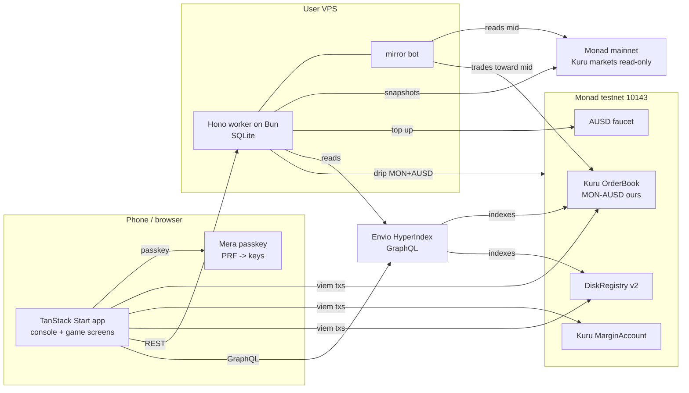

# MONADBOY

**A handheld game console where your liquidity is the game.**

The handheld that plays your liquidity.

**TESTNET** | STAY IN RANGE | Track 01: Onchain Finance & Trading

Pick a Monanimal, set your range, and watch a real testnet Kuru flip-order position as a handheld game.
SCORE is realized flip spread. DAMAGE is equally visible. Every number has a source you can open.
The app moves no real money; mainnet market data is read-only.

Video: added before submission

GIF: added before submission

The video slot is for a public demonstration no longer than three minutes [V: rules transcription, secondary](https://github.com/precious-akpan/monad-metropolis-merchant-rails).
Implementation and deployment status live in [the build plan](docs/technical/BUILD-PLAN.md). This README describes the approved build; pending proof is not a claim of completed integration.

## How it works

INSERT CARD uses a Mera passkey. Three SAVE DISKS have isolated account keys and separate sealing keys.
STAY IN RANGE places a ladder of Kuru flip-order pairs on our MON-AUSD testnet market.
Flip orders re-arm on the opposite side after fills [V: Kuru concept](https://docs.kuru.io/concepts/flip-orders).
An eligible flipped-order maker fill adds SCORE; the position's HODL-relative inventory accounting produces DAMAGE and NET.
Re-centering is manual, and its cost is shown before confirmation.



Chain IDs and public endpoints are [V: Monad current facts](https://docs.monad.xyz/ai/current-facts.md).
The mirror targets Kuru mainnet MON/USDC and labels play `TESTNET BOOK, MAINNET PRICE (KURU MON/USDC)`.
Source liveness was observed against real mainnet reads; the mirror pauses invalid/wide books. Final corrected-strategy continuous alignment and cost remain gated. USDC and AUSD are treated as one USD each [I], not measured parity.
The worker never signs for a user. Chain is truth; Envio and SQLite are read models.
The sealed disk lives onchain in DiskRegistry v2. Clearing site data must not remove the ability to restore with the same passkey.
Real-device restore remains [U: S4/B8]. Local S5 indexing passed with fresh564–570ms observations and exact SCORE parity; public hosting remains B2/B3.

## Why Monad

- **Game-tick feel:** 300ms mainnet blocks are verified; making a fill feel like a game tick is a product inference, not a latency guarantee [V: current facts](https://docs.monad.xyz/ai/current-facts.md) [I].
- **An onchain order book fits discrete play:** Kuru flip orders automatically alternate passive liquidity between paired prices [V: Kuru docs](https://docs.kuru.io/concepts/flip-orders). A ladder can be drawn as pixel ground and each eligible fill becomes an audible event [I].
- **Honest transaction costs:** Monad charges the declared gas limit, so each transaction passes explicit gas and the player sees the actual planned cost [V: gas pricing](https://docs.monad.xyz/developer-essentials/gas-pricing).
- **Account sequencing matters:** the reserve is 10 MON; low-balance undelegated senders can use the emptying exception only with no other sender transaction in the prior three blocks and no recent delegation change [V: reserve balance](https://docs.monad.xyz/developer-essentials/reserve-balance). The app sequences by blocks rather than assuming a fixed wait is safe.
- **Passkey-native ownership:** Mera's PRF output derives ordinary account keys, and the passkey is tied to the relying-party hostname [V: Mera guide](https://docs.monad.xyz/guides/mera). The production hostname is fixed before real cards are created.

## Bounty requirements and planned proof

Requirements are quoted where sourced. The feature column is a build commitment, not awarded eligibility.
Code paths and video timestamps are filled only after working evidence exists.

| Bounty | Requirement | Feature | Code path | Video timestamp |
| --- | --- | --- | --- | --- |
| Kuru Consumer Trading | “Build a new trading experience routed through Kuru's onchain order book” [V: sponsor statement](https://x.com/KuruExchange/status/2094830938463010922) | Funded native-card provision, flipped fill and exit observed | `apps/web/src/chain/market-execution.ts` | Not recorded |
| Mera UX | “Build an app on Monad where Mera is the entire account layer — no seed phrase, no extension, no custody backend.” [V: rules transcription, secondary](https://github.com/precious-akpan/monad-metropolis-merchant-rails) | Browser-only discovery/signing; physical-phone acceptance remains B8 | `apps/web/src/chain/card-session.ts`, `mera-backend.ts` | Not recorded |
| Mera UX stateless test | “Must pass the stateless test — judges clear local storage or open the app on a fresh device mid-demo, and identity/access must fully reconstruct from the passkey” [V: participant requirement citation, secondary](https://github.com/emmanuelist/curb/issues/40) | Funded first-run restore after eject/site-data clearing observed with a virtual reader; not physical-device proof | `apps/web/src/chain/shelf.ts`, `registry.ts` | Not recorded |
| Mera: One Passkey, Many Keys | “the most creative non-wallet use of Mera's PRF-derived key material” [V: playbook's participant citation, secondary](https://github.com/mryavascann/kaskad/pull/5) | Independent disk accounts and authenticated AES-GCM seals | `packages/sdk/src/mera.ts`, `seal.ts` | Not recorded |
| Agora Mobile Trading | Exact published requirement and mobile-web eligibility remain [U: organizer eligibility gate, with S4 mobile proof] | Real AUSD-quoted portrait trading; participation conditional on organizer confirmation | `apps/web/src/game/screens/FundedRange.tsx` | Not recorded |
| Envio | “Meaningfully use Envio's HyperIndex, HyperSync, or HyperRPC to power real on-chain data driving a core feature in your app.” [V: rules transcription, secondary](https://github.com/precious-akpan/monad-metropolis-merchant-rails) | Indexed fills drive gameplay/history/leaderboard; real outage/recovery and three-way SCORE parity observed | `indexer/src/handlers/`, `apps/worker/src/chain/indexed-fill-source.ts`, `apps/web/src/chain/gameplay.ts` | Not recorded |

Mera is the only account layer; other embedded-wallet providers are not integrated.
Agora cross-border payments are not targeted. Native app-store publication is outside scope.

## Addresses and deployment evidence

All rows below concern Monad testnet 10143 [V: current facts](https://docs.monad.xyz/ai/current-facts.md).
The four published addresses were independently checked on 2026-10-05 using:

```sh
cast code <address> --rpc-url https://testnet-rpc.monad.xyz
```

Non-empty code proves contract presence, not implementation semantics, funding, or approval safety.
[V] S1 delivered 10,000 AUSD and measured the global faucet cooldown; S2 established real flip, margin, encoding, cancellation and withdrawal semantics. See [SMART-CONTRACTS](docs/technical/SMART-CONTRACTS.md) for receipt-backed details.

| Component | Testnet address / deployment status | Verification | Deploy transaction hash |
| --- | --- | --- | --- |
| Kuru Router | `0x7EFbE105Ca7415dE98F96622173458ac1c054630` | [V] cast code: 141 bytes | pending |
| Kuru MarginAccount | `0xd029C2D98ff85D8F64799017fE00a59B1159CE02` | [V] cast code: 141 bytes | pending |
| AUSD token | `0xa9012a055bd4e0eDfF8Ce09f960291C09D5322dC` | [V] cast code: 5,937 bytes; [Agora deployment list](https://docs.agora.finance/developer/contract-deployments.md) | pending |
| AUSD faucet | `0xd236c18D274E54FAccC3dd9DDA4b27965a73ee6C` | [V] cast code: 1,200 bytes; [Agora deployment list](https://docs.agora.finance/developer/contract-deployments.md) | pending |
| Our MON-AUSD market | `0xD9F66B3bdBb1741f33e01fA3Acb514623e0a60Bc` | [V] 141-byte code, live params and S2 receipts | `0xa7877c745f7d3f3011bd589e78095c3175c845d14f7b1689d41af8d9ca3a52bc` |
| DiskRegistry v2 | `0xbfc885C572Cb1121FC4e4e82434279c4B4302714` | [V] 1,885-byte runtime exactly matches artifact; perfect source verification | `0xaf7a396b8f73814ba6fac77829c73e632f4ec1c2e0dfa83cfa1e9f50354229af` |

Checked-in SDK manifests record deployment metadata. The registry deployment command defaults to unsigned verification and reuses the existing receipt, never silently deploying again.
The smart-contract document owns parameters and the full deploy log.

## Run locally

The web app, SDK, worker, registry and local self-hosted indexer have actual funded runtime evidence. S5 passed; physical-phone passkeys, fixed-domain public deployment and final continuous mirror economics remain gated in [docs/BLOCKERS.md](docs/BLOCKERS.md). Mainnet reads alone do not prove testnet execution.

Prerequisites: Bun1.3 for workspace installation/scripts, Node24 for Vite/Vitest, Foundry1.8.x for contracts, and Docker Desktop/Linux Engine for the separately pinned indexer.

```sh
bun install
bun run dev
# In another terminal, with transactions disabled in the ignored worker .env:
bun run --cwd apps/worker dev
# Workspace quality gate:
bun run verify
# From contracts:
forge test
```

[V, 2026-10-07] A fresh local clone of `7268a17` installed832packages with
`bun install --frozen-lockfile` and passed `bun run verify`: web551, SDK153,
worker133 tests, all three typechecks and ESLint. No private environment,
generated indexer runtime or dependency directory was copied into that clone.
The separately locked Linux indexer also passed clean-volume install/codegen,
typecheck and four native projection tests. These local checks do not establish
physical-device support, public hosting, remote CI or continuous mirror economics.

The guard is available now. For explicit files:

```sh
bun scripts/guard-forbidden.ts README.md CLAUDE.md AGENTS.md docs/PRD.md docs/DESIGN-SYSTEM.md docs/LESSONS.md
```

Create ignored `apps/web/.env.local` and `apps/worker/.env` from their `.env.example` files.
Set `VITE_WORKER_URL` to the worker origin and worker `APP_ORIGIN` to the exact web origin. Missing/failed reads have explicit states, not fixture fallbacks.
Set `VITE_RP_ID` to the chosen stable hostname. The verified registry/market manifests are defaults; optional registry/RPC overrides must target chain10143. `VITE_RP_NAME` is optional. Never reuse disposable tunnel cards as production cards.
To walk the marked screen simulation locally, set `VITE_USE_FIXTURES=true` in the web development environment. Production builds ignore it. `/` is the landing page; `/play` is the handheld. RULE BOOK on desktop and GUIDE on phones open current-screen actions first, with gameplay and control sections on demand. H or ? toggles it. VOL controls effects/music; zero is silent, an adjustment clears mute, and M mutes/restores the saved level. There is no separate mute button.
The development-only `/dev/passkey` page exercises disposable WebAuthn create/restore, disk signing and local authenticated sealing without a transaction. It is not a production route or physical-device support claim.
Worker configuration and safety policy are documented in [deploy/README.md](deploy/README.md). Keep `ENABLE_TRANSACTIONS=false` for read-only development; unattended signing requires final continuous mirror/cost acceptance, not just a successful deployment.
Bot, drip, and deployer keys are distinct local / VPS secrets. Never put secret values in the browser or repository.
Use HTTPS or localhost for passkeys [V: Mera guide](https://docs.monad.xyz/guides/mera); test supported authenticators before claiming restore works [U: S4].

### Selected public hosting

Frontend hosting is Vercel with a fixed production hostname. The worker, its
SQLite ledger, Envio, PostgreSQL and Hasura target the VPS; Supabase is not required.
The browser signs for players, never the worker. Backend and public read-only
GraphQL endpoints need HTTPS and the exact frontend-origin configuration.
Local Docker and the development preview are not public judge-access proof.
Vercel deployment, target service recovery,24-hour monitoring and physical-phone
create/restore remain acceptance gates. Keep the bot disabled until B10 passes.

### Local indexed history

The indexer is a separate Linux package, not a Bun workspace. Create ignored `indexer/.env` from `.env.example`; choose local Postgres/Hasura admin secrets privately and use the existing authenticated HyperSync token for `ENVIO_API_TOKEN`. No admin secret belongs in a `VITE_` variable.

```sh
cd indexer
docker compose build indexer
docker compose run --rm --no-deps --entrypoint sh indexer -c "pnpm install --frozen-lockfile"
docker compose run --rm --no-deps --entrypoint node indexer node_modules/envio/bin.mjs codegen
docker compose up -d --wait postgres graphql indexer
docker compose run --rm --no-deps --entrypoint sh indexer -c "pnpm typecheck && pnpm test"
```

Read-only GraphQL is `http://localhost:18880/v1/graphql`. Set web `VITE_ENVIO_GRAPHQL_URL` and worker `ENVIO_GRAPHQL_URL` to that endpoint; browser/worker origins must match their environment configuration. Inspect `_meta` coverage and processed block before treating fills as complete. Live-RPC fresh-fill observations passed at564–570ms after an initial16.620second miss. Actual GraphQL outage recovered through direct logs and returned to indexed reads after restart. Missing older fallback coverage remains explicitly incomplete.


## Documentation

- [Product requirements](docs/PRD.md): vocabulary, rules, mechanics, screens, scope.
- [Design system](docs/DESIGN-SYSTEM.md): palette, grid, type, motion, sprites.
- [Architecture](docs/technical/ARCHITECTURE.md): stack, component ownership, data flows.
- [Integrations](docs/technical/INTEGRATIONS.md): external boundaries and failures.
- [Smart contracts](docs/technical/SMART-CONTRACTS.md): registry, market surface, deployment proof.
- [Data model](docs/technical/ERD.md): chain, indexer, cache, sealed records.
- [Build plan](docs/technical/BUILD-PLAN.md): phase status and unresolved gates.
- [Blockers](docs/BLOCKERS.md): exact external gates, settling evidence and resolution history.
- [Lessons](docs/LESSONS.md): root causes and durable rules.

## AI disclosure

Built with Claude Code and OMP agents; all code reviewed and committed by the team

## License

MIT. See [LICENSE](LICENSE).
