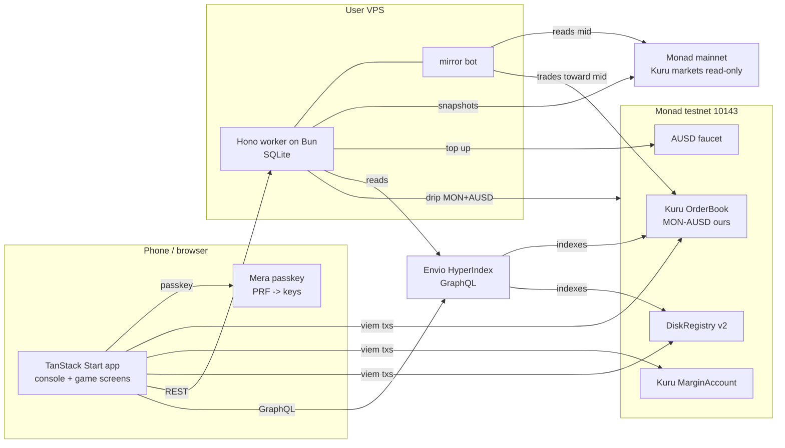

# MONADBOY

**A handheld game console where your liquidity is the game.**

The handheld that plays your liquidity.

**TESTNET** | STAY IN RANGE | Track 01: Onchain Finance & Trading

Pick a Monanimal, set your range, and watch a real testnet Kuru flip-order position as a handheld game.
SCORE is realized flip spread. DAMAGE is equally visible. Every number has a source you can open.
The app moves no real money; mainnet market data is read-only.

Video: added before submission

GIF: added before submission

The video slot is for a public demonstration no longer than three minutes [V: rules transcription, secondary](https://github.com/precious-akpan/monad-metropolis-merchant-rails).
Implementation and deployment status live in [the build plan](docs/technical/BUILD-PLAN.md). This README describes the approved build; pending proof is not a claim of completed integration.

## How it works

INSERT CARD uses a Mera passkey. Three SAVE DISKS have isolated account keys and separate sealing keys.
STAY IN RANGE places a ladder of Kuru flip-order pairs on our MON-AUSD testnet market.
Flip orders re-arm on the opposite side after fills [V: Kuru concept](https://docs.kuru.io/concepts/flip-orders).
An eligible flipped-order maker fill adds SCORE; the position's HODL-relative inventory accounting produces DAMAGE and NET.
Re-centering is manual, and its cost is shown before confirmation.



Chain IDs and public endpoints are [V: Monad current facts](https://docs.monad.xyz/ai/current-facts.md).
The mirror targets Kuru mainnet MON/USDC and labels play `TESTNET BOOK, MAINNET PRICE (KURU MON/USDC)`.
Source liveness and trading behavior are [U: S2 and Phase 6 mirror proof]. USDC and AUSD are treated as one USD each [I], not measured parity.
The worker never signs for a user. Chain is truth; Envio and SQLite are read models.
The sealed disk lives onchain in DiskRegistry v2. Clearing site data must not remove the ability to restore with the same passkey.
Real-device restore is [U: S4]; hosted indexing availability is [U: S5].

## Why Monad

- **Game-tick feel:** 300ms mainnet blocks are verified; making a fill feel like a game tick is a product inference, not a latency guarantee [V: current facts](https://docs.monad.xyz/ai/current-facts.md) [I].
- **An onchain order book fits discrete play:** Kuru flip orders automatically alternate passive liquidity between paired prices [V: Kuru docs](https://docs.kuru.io/concepts/flip-orders). A ladder can be drawn as pixel ground and each eligible fill becomes an audible event [I].
- **Honest transaction costs:** Monad charges the declared gas limit, so each transaction passes explicit gas and the player sees the actual planned cost [V: gas pricing](https://docs.monad.xyz/developer-essentials/gas-pricing).
- **Account sequencing matters:** the reserve is 10 MON; low-balance undelegated senders can use the emptying exception only with no other sender transaction in the prior three blocks and no recent delegation change [V: reserve balance](https://docs.monad.xyz/developer-essentials/reserve-balance). The app sequences by blocks rather than assuming a fixed wait is safe.
- **Passkey-native ownership:** Mera's PRF output derives ordinary account keys, and the passkey is tied to the relying-party hostname [V: Mera guide](https://docs.monad.xyz/guides/mera). The production hostname is fixed before real cards are created.

## Bounty requirements and planned proof

Requirements are quoted where sourced. The feature column is a build commitment, not awarded eligibility.
Code paths and video timestamps are filled only after working evidence exists.

| Bounty | Requirement | Feature | Code path | Video timestamp |
| --- | --- | --- | --- | --- |
| Kuru Consumer Trading | “Build a new trading experience routed through Kuru's onchain order book” [V: sponsor statement](https://x.com/KuruExchange/status/2094830938463010922) | STAY IN RANGE places testnet flip ladders; show a real fill and explorer proof | pending | pending |
| Mera UX | “Build an app on Monad where Mera is the entire account layer — no seed phrase, no extension, no custody backend.” [V: rules transcription, secondary](https://github.com/precious-akpan/monad-metropolis-merchant-rails) | INSERT CARD owns signing, discovery, and restore without a custody service | pending | pending |
| Mera UX stateless test | “Must pass the stateless test — judges clear local storage or open the app on a fresh device mid-demo, and identity/access must fully reconstruct from the passkey” [V: participant requirement citation, secondary](https://github.com/emmanuelist/curb/issues/40) | Clear site data or use another phone; restore all three sealed disk slots | pending | pending |
| Mera: One Passkey, Many Keys | “the most creative non-wallet use of Mera's PRF-derived key material” [V: playbook's participant citation, secondary](https://github.com/mryavascann/kaskad/pull/5) | Separate PRF-derived AES-GCM keys seal private disk data; ciphertext is onchain | pending | pending |
| Agora Mobile Trading | Exact published requirement and mobile-web eligibility remain [U: organizer eligibility gate, with S4 mobile proof] | AUSD-quoted, portrait-first PWA trading; participation conditional on organizer confirmation | pending | pending |
| Envio | “Meaningfully use Envio's HyperIndex, HyperSync, or HyperRPC to power real on-chain data driving a core feature in your app.” [V: rules transcription, secondary](https://github.com/precious-akpan/monad-metropolis-merchant-rails) | HyperIndex powers S7 fills, S8 history, and leaderboard SCORE derived from trades | pending | pending |

Mera is the only account layer; other embedded-wallet providers are not integrated.
Agora cross-border payments are not targeted. Native app-store publication is outside scope.

## Addresses and deployment evidence

All rows below concern Monad testnet 10143 [V: current facts](https://docs.monad.xyz/ai/current-facts.md).
The four published addresses were independently checked on 2026-10-05 using:

```sh
cast code <address> --rpc-url https://testnet-rpc.monad.xyz
```

Non-empty code proves contract presence, not implementation semantics, funding, or approval safety.
S1 settles AUSD supply and faucet cadence; S2 settles flip, margin, encoding, and exit behavior [U].

| Component | Testnet address / deployment status | Verification | Deploy transaction hash |
| --- | --- | --- | --- |
| Kuru Router | `0x7EFbE105Ca7415dE98F96622173458ac1c054630` | [V] cast code: 141 bytes | pending |
| Kuru MarginAccount | `0xd029C2D98ff85D8F64799017fE00a59B1159CE02` | [V] cast code: 141 bytes | pending |
| AUSD token | `0xa9012a055bd4e0eDfF8Ce09f960291C09D5322dC` | [V] cast code: 5,937 bytes; [Agora deployment list](https://docs.agora.finance/developer/contract-deployments.md) | pending |
| AUSD faucet | `0xd236c18D274E54FAccC3dd9DDA4b27965a73ee6C` | [V] cast code: 1,200 bytes; [Agora deployment list](https://docs.agora.finance/developer/contract-deployments.md) | pending |
| Our MON-AUSD market | deployed in Phase 5 | checked after deploy [U: S2 / Phase 5] | pending |
| DiskRegistry v2 | deployed in Phase 4 | checked after deploy [U: Phase 4 gate] | pending |

Our contract and market rows contain no provisional addresses. Their exact addresses and receipt hashes are recorded after deployment and code checks.
The smart-contract document owns parameters and the full deploy log.

## Run locally

Phase 1 writes documentation. Task 2.1 adds the frontend toolchain; worker, contracts, and indexer commands arrive with their implementation phases.
Do not mistake the planned commands below for runnable application surfaces in the docs phase.

Prerequisites: Bun 1.3 for installation / scripts, Node 24 for Vite / Vitest, and Foundry 1.8.x for contract work.

```sh
bun install
bun run dev
# In another terminal, after worker implementation:
bun run --cwd apps/worker dev
# After indexer implementation:
bun run --cwd indexer codegen
bun run --cwd indexer dev
# Quality gate after Task 2.1:
bun run verify
# From contracts, after contract implementation:
forge test
```

The guard is available now. For explicit files:

```sh
bun scripts/guard-forbidden.ts README.md CLAUDE.md AGENTS.md docs/PRD.md docs/DESIGN-SYSTEM.md docs/LESSONS.md
```

Create local, ignored environment files from the app examples when they land.
Web configuration includes VITE_CHAIN=testnet, VITE_RP_ID, VITE_RP_NAME=MONADBOY, VITE_WORKER_URL, VITE_ENVIO_GRAPHQL_URL, and optional VITE_TESTNET_RPC_URL.
Worker configuration includes RPC URLs, APP_ORIGIN, WORKER_PORT, SQLITE_PATH, ENVIO_GRAPHQL_URL, and MARKETS_JSON.
Bot, drip, and deployer keys are distinct local / VPS secrets. Never put secret values in the browser or repository.
Use HTTPS or localhost for passkeys [V: Mera guide](https://docs.monad.xyz/guides/mera); test supported authenticators before claiming restore works [U: S4].

## Documentation

- [Product requirements](docs/PRD.md): vocabulary, rules, mechanics, screens, scope.
- [Design system](docs/DESIGN-SYSTEM.md): palette, grid, type, motion, sprites.
- [Architecture](docs/technical/ARCHITECTURE.md): stack, component ownership, data flows.
- [Integrations](docs/technical/INTEGRATIONS.md): external boundaries and failures.
- [Smart contracts](docs/technical/SMART-CONTRACTS.md): registry, market surface, deployment proof.
- [Data model](docs/technical/ERD.md): chain, indexer, cache, sealed records.
- [Build plan](docs/technical/BUILD-PLAN.md): phase status and unresolved gates.
- [Lessons](docs/LESSONS.md): root causes and durable rules.

## AI disclosure

Built with Claude Code and OMP agents; all code reviewed and committed by the team

## License

MIT. See [LICENSE](LICENSE).
