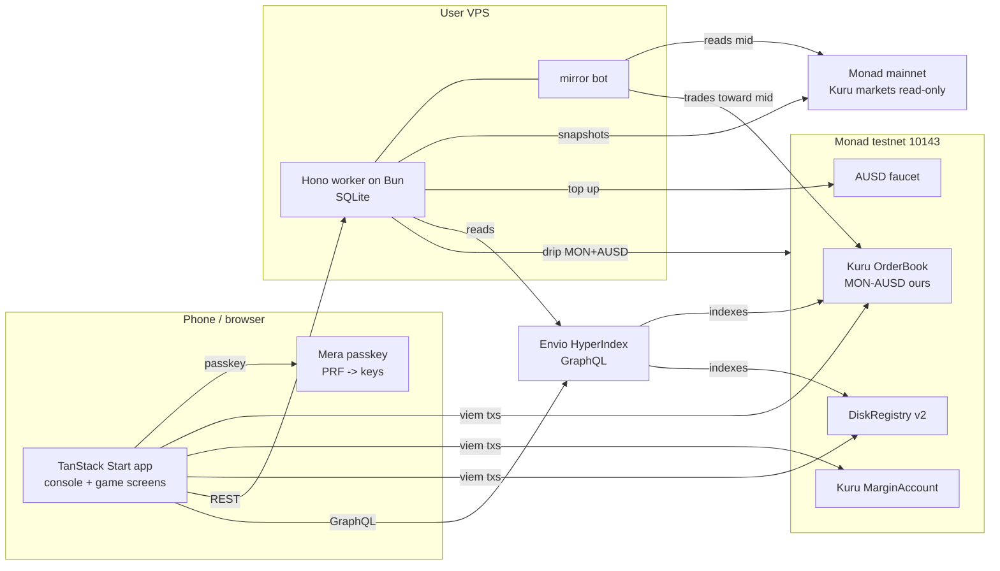

# MONADBOY architecture

MONADBOY runs STAY IN RANGE on a testnet Kuru flip-order ladder. The tagline is "The handheld that plays your liquidity." Chain state is authoritative; Envio and SQLite are read models. Local services and testnet contracts have runtime evidence; VPS/HTTPS deployment remains gated by domain and access.

Labels: **[V]** verified with the linked source or command; **[I]** inference or planned integration; **[U]** unresolved, with the settling spike named. Contract addresses and deployment evidence belong in [SMART-CONTRACTS](SMART-CONTRACTS.md); failure behavior belongs in [INTEGRATIONS](INTEGRATIONS.md).

## 1. System map

[I] Intended connectivity below. [V] Monad testnet is chain 10143 and mainnet is chain 143; public RPCs are `https://testnet-rpc.monad.xyz` and `https://rpc.monad.xyz` ([network facts](https://docs.monad.xyz/ai/current-facts.md)). All playable positions use testnet. Mainnet has public clients only, never signing clients.

## 2. Components and ownership

### Current tracked layout

[V] Implemented boundaries below. [BUILD-PLAN](BUILD-PLAN.md) owns task status and completion proof; local execution is not public-deployment acceptance.

| Path | Owns | Boundary |
|---|---|---|
| `apps/web` | TanStack Start screens/routes, Mera sessions, registry sealing, player-signed Kuru transactions and read models | No ops secrets, worker imports or mainnet signing |
| `apps/web/src/console` | Shell, input, contextual controls and portrait layout | No money logic; lint/test enforce it |
| `apps/worker` | Hono REST, SQLite, mainnet tracker/source, testnet mirror/drip and leaderboard | Separate BOT/DRIP keys; never signs for players |
| `packages/sdk` | Typed ABIs, deployment/market manifests, encodings, ladder, valuation, seal, Mera derivation and receipt-backed gas samples | No React/DOM; shared numeric definitions |
| `contracts` | DiskRegistry v2, tests, gas snapshot and pinned forge-std | No funds/admin; registry receipt and source verified |
| `indexer` | Pinned HyperIndex config/schema/projections and local Compose services | Public read-only GraphQL, server-only admin authentication, no self-reported SCORE |
| `scripts` | Content guard, idempotent registry deployment and bounded network-semantic probes | No tracked secrets; deployment defaults to read-only verification |
| `tools/sprites`, `assets`, `apps/web/public` | Art-processing tools, source art, runtime fonts/sprites | Runtime assets stay distinct from source art |
| `docs` | Product/design/lessons, sourced research and technical contracts | BUILD-PLAN is the live checklist |
| `.claude/skills`, `.githooks`, `.github`, `.vscode` | Tracked guidance, content hooks, CI and editor settings | No machine-local secret/config state |

Shared SDK names: `planLadder`, `batchProvisionArgs`, `scoreCard`, `rangeState`, `deriveSealKey`, `sealDisk`, `openDisk`, `diskAddresses`, `FillSource`, `decideMirrorAction`. Pure functions own arithmetic; the browser and worker own effects. No model is in any number's critical path.

## 3. Technology and runtime

Versions below are the approved toolchain targets. An exact version here is not a claim that dependencies are already installed. Resolve ranges and pin their concrete versions when the corresponding package is introduced; viem is pinned in Phase 2.

| Layer | Package / runtime | Version |
|---|---|---|
| Install and scripts | Bun | 1.3 |
| Vite / Vitest runtime | Node | 24 |
| Types | TypeScript | 6.0.3 |
| Application | TanStack Start | 1.168.60 |
| Routing | TanStack Router | 1.170.41 |
| Server-state cache | TanStack Query | 5.102.0 |
| Router/query SSR bridge | `@tanstack/react-router-ssr-query` | 1.167.3 |
| UI | React | 19.2.8 |
| Build | Vite | 8.2.0 |
| Vercel adapter | Nitro | 3.0.260903-beta |
| Tests | Vitest | 4.1.10 |
| DOM test environment | jsdom | 30.0.1 |
| CSS | Tailwind | 4.3.3 |
| Animation | motion | 12.43.0 |
| Validation | zod | 4.4.3 |
| Local state | zustand | 5.0.14 |
| Chain I/O | viem | latest 2.x satisfying ^2.28.0; pinned in Phase 2 |
| Passkeys | `@category-labs/mera` | 0.2.0 |
| Derivation | `@scure/bip32`, `@scure/bip39` | concrete versions pinned when installed; PLAN specifies no versions |
| Worker HTTP | Hono | latest 4.x on Bun |
| Worker database | `bun:sqlite` | bundled with Bun |
| Indexer | Envio HyperIndex | 3.0.0-alpha.21, separate Linux package |
| Contract tools | Foundry | 1.8.x |
| Contract language | Solidity | 0.8.28 |

Bun installs dependencies and runs scripts and the worker. **Node 24 runs Vite and Vitest.** jsdom 30 requires Node 22+; reject an unsupported test runtime rather than diagnosing missing undici APIs as application failures. The worker uses Bun's native SQLite API, not Node's SQLite API.

[I] Kuru SDK 0.0.95 is an ABI and arithmetic reference only, not a runtime dependency. Vendor typed ABIs and use viem for every chain operation; source provenance is recorded in [Kuru research](../research/kuru.md). Mera must be client-only, behind a client-only function or effect boundary, never imported into a server execution path.

## 4. Environment variables

Each app has its own `.env.example` containing names and harmless defaults, never secret values. Actual `.env` files stay untracked.

| Scope | Name | Purpose |
|---|---|---|
| Web | `VITE_CHAIN=testnet` | Playable chain selection |
| Web | `VITE_RP_ID` | Fixed production hostname |
| Web | `VITE_RP_NAME=MONADBOY` | Passkey relying-party display name |
| Web | `VITE_WORKER_URL` | Worker REST base URL |
| Web | `VITE_ENVIO_GRAPHQL_URL` | Fill and history read model |
| Web | `VITE_TESTNET_RPC_URL` | Optional QuickNode or public testnet RPC |
| Web | `VITE_REGISTRY_ADDRESS` | DiskRegistry v2 checked for code on chain 10143 |
| Web | `VITE_USE_FIXTURES` | Explicit development opt-in only; ignored by production builds |
| Worker | `WORKER_PORT` | Hono listener |
| Worker | `WORKER_BIND` | Loopback default; exact host bridge gateway for container Caddy, never a public interface |
| Worker | `TRUSTED_PROXY_IP` | Optional exact IPv4 peer permitted to supply forwarded drip quota addresses; no CIDR or hostname trust |
| Worker | `APP_ORIGIN` | Only allowed CORS origin |
| Worker | `TESTNET_RPC_URL` | Bot, drip and testnet reads |
| Worker | `MAINNET_RPC_URL` | Read-only tracker and price source |
| Worker | `BOT_PRIVATE_KEY` | Dedicated mirror signing key |
| Worker | `DRIP_PRIVATE_KEY` | Separate drip signing key |
| Worker | `SQLITE_PATH` | Cache and drip-ledger database |
| Worker | `ENVIO_GRAPHQL_URL` | Indexed fill/history read model; direct-log fallback when unhealthy |
| Worker | `MARKETS_JSON` | Path to deployed market configuration |
| Scripts / contracts | `DEPLOYER_PRIVATE_KEY` | Deployment key |

Generate ops keys with `cast wallet new`; keep them only in VPS/local `.env` files and have the user fund them. Bot and drip use different keys. Every `VITE_` variable is public; no ops key belongs there.

## 5. Hosting and session lifetime

[V, 2026-10-08] Frontend: **https://monadboy-play.vercel.app**, persisted as the Vercel project's production domain, with `VITE_RP_ID=monadboy-play.vercel.app`. The requested `monadboy.vercel.app` was already assigned; the user approved the available alternative. The default project domain redirects to the canonical host with HTTP308. Nitro produces the Vercel deployment output; anonymous Edge rendered the landing at1440x900 and card at412x915 and exercised the START handoff. Production passkey-device acceptance is separate. [V] Passkeys bind to the relying-party hostname ([Mera guide](https://docs.monad.xyz/guides/mera)); development-tunnel passkeys are disposable.

[I, user-selected hosting] Bun/Hono, persistent SQLite and Envio/PostgreSQL/Hasura target the VPS. SSH access is verified. After pausing only the three approved Mandate containers, the VPS had830MiB available RAM and12GiB free disk; the local indexing stack used about317MiB at startup. These observations support a bounded VPS deployment, not peak-load or24-hour acceptance. Move PostgreSQL to a managed service only if actual capacity fails. [V] Local Postgres17.5/Hasura2.43.0 indexing passed S5 fresh-fill observations at564–570ms with exact SCORE parity and outage recovery. Healthy containers alone do not prove complete maker-basis coverage: the read-only worker disclosed unavailable indexed coverage and a PARTIAL direct-log leaderboard. Public backend HTTPS/restart, final continuous mirror economics and24-hour proof remain gates; retain hosting through4November pending the organizer-date conflict.

[V] Mera supplies `createPasskeyWithPrfOutput`, `getPasskeyPrfOutput`, `createSecp256k1SigningSession` and `toViemAccount` from `@category-labs/mera/viem` ([guide](https://docs.monad.xyz/guides/mera)). Hold signing sessions while the console is on; end on eject, explicit EJECT CARD, or tab hidden for more than ten minutes. Only credential ID and transports persist locally. Account index 0 supplies the display-only card serial; indices 1, 2 and 3 identify the isolated disks.

## 6. Per-screen data flow

This table is the screen boundary contract. "None" means no boundary operation, not a fabricated response. S2 execution semantics and S5 indexed latency/parity have receipt-backed evidence; physical-device Mera support remains [U, S4].

| Screen | Reads | Writes / actions |
|---|---|---|
| S1 INSERT MEMORY CARD | Mera discoverable passkey or optional local credential metadata; derive index-0 serial | NEW CARD calls `createPasskeyWithPrfOutput`; INSERT CARD calls `getPasskeyPrfOutput`; hold sessions; persist only credential ID/transports. No worker, Envio or Kuru call |
| S2 SAVE DISK | `diskAddresses()` derives slots 1..3; `DiskRegistry.diskOf` for each; `openDisk` decrypts locally; direct testnet balances when displayed | New disk requests `POST /v1/drip {address}` for fresh-account funding; `deriveSealKey` + `sealDisk` then `DiskRegistry.save`; edits save ciphertext; erase calls `erase`. OPEN exposes ciphertext hash and explorer proof. No Envio required for restore |
| S3 CARTRIDGE | Selected decrypted disk and session state | Select STAY IN RANGE or open leaderboard; locked COMING SOON remains locked. No boundary writes |
| S4 DIFFICULTY | Decrypted disk preferences, shared SDK gates and validated worker counts | Re-read/decrypt latest disk, preserve name/notes/history, seal and save selected profile; proceed after a matching confirmed DiskSaved event. No Envio or Kuru transaction |
| S5 POOL TRACKER | `GET /v1/tracker`, including mainnet SAFETY/HEAT inputs, timestamp and testnet playable mapping | Select only a PLAYABLE (TESTNET) market; MAINNET ONLY is read-only. Worker reads Kuru mainnet books/logs for snapshots; web performs no mainnet writes |
| S6 SET RANGE | `GET /v1/mid?market=`, tracker volatility, testnet Kuru params, balances, allowance; `planLadder` and `batchProvisionArgs` | Explicit-gas approval if needed, quote deposit, margin market-buy zap, `batchProvisionLiquidity`, receipt IDs; sealed save does not block play |
| S7 IN RANGE | Poll `/v1/mid` every 5 s; `/v1/health`; Envio fills or last 200 blocks of `Trade` via viem; direct Kuru balances/resting orders for `scoreCard`; `rangeState` | Manual RE-CENTER cancels, withdraws, replans and provisions only after cost confirmation; WITHDRAW starts exit. Native flips re-arm onchain, not through worker signing |
| S8 RESULTS | Cancellation/withdrawal receipts; Envio history or log fallback; valuation inputs and run timing | Re-read live orders, cancel one representative per linked flip pair, then `batchWithdrawMaxTokens` for native MON and AUSD; append run, seal and `DiskRegistry.save`; show each result's source/tx link |
| LEADERBOARD | `GET /v1/leaderboard?window=24h|7d|all`; worker combines Envio fills through `FillSource` with `mid_samples` | No player write; worker refreshes its cache every 60 s. Never accept a self-reported SCORE |

Restore is passkey -> three derived addresses -> registry reads -> local decrypt, with **no server or localStorage requirement**. A worker outage must not break it.

[V] Native browser WebAuthn with a virtual PRF-capable authenticator restored the same three addresses after site-data clearing. Both isolated Anvil and funded Monad testnet accepted sealed saves. Funded S6 provision, flipped-maker fill, S8 exit and first-run stateless restore were observed. The second run was sealed and displayed on the shelf; its repeat restore was not established after the disposable reader became unavailable. Physical-phone acceptance remains B8. Virtual credentials were memory-only; loss of that reader is not an acceptable production recovery mechanism.

Production routes never use fixture responses after missing configuration, failed reads or unavailable deployment. S2-backed configuration enables real S6-S8 execution; incomplete history and source failures remain visible. `/dev/passkey` is Vite-development middleware outside the application route graph; it creates disposable hostname-bound cards and sends no transaction.

## 7. Worker and transaction flow

[I] Hono exposes JSON endpoints `GET /v1/health`, `GET /v1/mid?market=`, `GET /v1/tracker`, `GET /v1/leaderboard?window=24h|7d|all`, and `POST /v1/drip`. Validate every input with zod; restrict CORS to `APP_ORIGIN`. No endpoint signs on behalf of a player.

[I] Jobs: mirror and mid-sampler every 5 s, tracker-snapshot every 15 min, leaderboard every 60 s, faucet-topup with cadence-sensitive backoff. `decideMirrorAction` compares the testnet mid with Kuru mainnet MON_USDC; above 0.05% deviation it takes liquidity toward the target, capped per tick, then refreshes thin quotes at target +/-0.1%. USDC and AUSD are treated as 1 USD for this mirror [I], not a claim of a live peg. Label it "testnet book, mainnet price (Kuru MON/USDC)". Three consecutive source-read failures pause the bot, turn health red and show "PRICE FEED PAUSED".

[V] Monad charges the declared gas limit ([gas pricing](https://docs.monad.xyz/developer-essentials/gas-pricing)); every transaction supplies explicit `gas`. [V] The reserve balance is 10 MON and the emptying exception requires an undelegated sender with no transaction or delegation change in the previous k=3 blocks ([reserve balance](https://docs.monad.xyz/developer-essentials/reserve-balance)). Use block-based spacing for low-balance value-spending transactions, including after a preceding approval; do not substitute a wall-clock sleep or a claim that spacing only two value transfers is enough.

Funds left by a partially completed sequence remain in the player's account or Kuru MarginAccount. Preserve transaction links and WITHDRAW recovery; never fake success. Every screen with balances says TESTNET. Every number has an inspectable source; SCORE and DAMAGE have equal visual weight.
