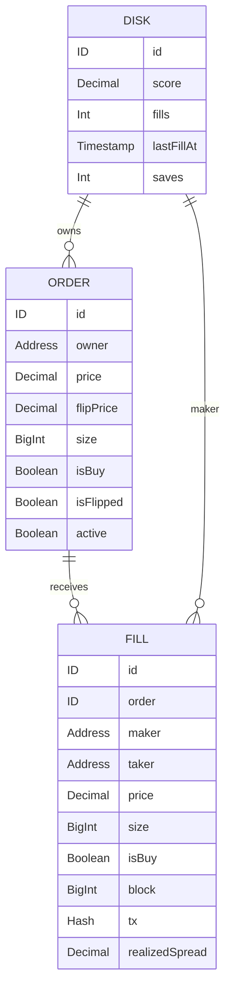

# MONADBOY data model

Chain state is truth. Envio is an event-derived read model; SQLite is a cache and operations ledger. Sealed disk contents are decrypted only on the player's device. Labels: **[V]** verified source/command; **[I]** inference or intended integration; **[U]** unresolved with its settling spike. The schemas below are the approved build contract, not tables already deployed.

## 1. State boundaries

| Layer | Authoritative for | Not authoritative for |
|---|---|---|
| DiskRegistry v2 | Public disk metadata and exact sealed bytes | SCORE or leaderboard rank |
| Kuru OrderBook / MarginAccount | Orders, fills and margin balances | Private disk preferences |
| Envio HyperIndex | Indexed projection of contract events | State beyond its indexed block |
| Worker SQLite | Drip attempts/limits and mirror operations ledger | Ownership, confirmed fills or chain balances |
| Browser memory | Active session, transient decrypted disk and seal key | Durable restore; no local state is required to restore |

[I] Contracts and indexing target Monad testnet; worker tracker and mirror-source reads target mainnet. [V] Network IDs are 10143 and 143 respectively ([network facts](https://docs.monad.xyz/ai/current-facts.md)). No mainnet player transactions exist in this design.

## 2. Onchain state

### DiskRegistry v2

Key: disk account (`msg.sender` on writes). Value: `Disk` from [SMART-CONTRACTS](SMART-CONTRACTS.md).

| Field | Solidity type | Meaning |
|---|---|---|
| `createdAt` | `uint64` | First save timestamp; preserved on overwrite |
| `updatedAt` | `uint64` | Most recent save timestamp |
| `difficulty` | `uint8` | 0..2; separate from GOD MODE |
| `godMode` | `bool` | Modifier; cannot bypass unsellable-token gate |
| `tag` | `bytes12` | Public tag |
| `sealed` | `bytes` | Versioned encrypted disk blob, at most 2,048 bytes |

A missing or erased disk has zero metadata and empty sealed bytes. Empty sealed bytes are the discovery test from the approved restore path. The metadata occupies one packed slot; dynamic bytes has a separate header and payload storage. No onchain score field is accepted.

### Kuru orders and balances

[V] OrderBook stores orders with owner, size, prev, next, flippedId, price, flippedPrice and isBuy ([OrderBook structures](https://docs.kuru.io/contracts/OrderBook)). Treat the prose function/event signatures separately from live ABI evidence. [V] MarginAccount maintains user/token balances and exposes `getBalance(user, token)` ([MarginAccount](https://docs.kuru.io/contracts/MarginAccount)). Native MON is the `address(0)` argument sentinel, not an ERC-20 deployment.

| State | Join / identity | Consumer |
|---|---|---|
| Resting order | Market + order ID, owned by a derived disk address | S7 ladder, locked inventory and exit |
| Flip relationship | Created/flipped order IDs from live events | Distinguish initial fills from realized spread |
| Margin balance | Disk address + token | Provisioning, valuation and withdrawal |
| `Trade` log | Chain + block/log identity and transaction | SCORE, fill sound, history and leaderboard |

[U, S2] Confirm actual order funding, price/size encoding, re-arm behavior and cancellation release on testnet. Deposited inventory and resting inventory must not be counted twice in valuation.

## 3. Envio HyperIndex entities

[I] Index our testnet market(s) and DiskRegistry v2 from deployment blocks. [U, S5] Prove sync within 10 s and settle hosted versus self-hosted execution. [V] Envio documents Monad support ([chain page](https://envio.dev/chains/monad)); this does not prove our specific testnet pipeline is operating.

These are the exact approved entity fields. `Disk` here is an event-derived aggregate, **not** the Solidity struct and not private save JSON. Public difficulty/GOD MODE/tag can be read from registry state when needed rather than invented as extra entity fields.

| Entity | Fields |
|---|---|
| `Market` | `id, lastPrice, volume24h` |
| `Order` | `id, owner, price, flipPrice, size, isBuy, isFlipped, active` |
| `Fill` | `id, order, maker, taker, price, size, isBuy, block, tx, realizedSpread` |
| `Disk` | `id, score, fills, lastFillAt, saves` |

[I] Use market-qualified order identity when indexing multiple books, since numeric order IDs need not be globally unique. Fill identity must include log identity, not just a transaction hash, because one transaction can emit several fills. These are identity design choices, not added schema fields.



[I] Diagram types communicate semantics; actual GraphQL scalar choices are recorded when the schema is implemented. The owner/maker joins refer to disk addresses, not to a server account or passkey credential. `Market` is maintained per indexed book; market qualification lives in entity identity without changing the approved fields.

### Event projection

Index `FlipOrderCreated`, `FlippedOrderCreated`, `FlipOrderUpdated`, `FlipOrdersCanceled`, `Trade`, `OrdersCanceled`, `DiskSaved`, `DiskErased` using live SDK signatures. [V] The approved live `Trade` signature is `Trade(uint40,address,bool,uint256,uint96,address,address,uint96)`, not the uint32-price prose example (ABI/log evidence in [Kuru research](../research/kuru.md)).

`Trade` computes `Fill.realizedSpread` and `Disk.score` using `scoreCard`'s SCORE rule: sum `abs(flipPrice - price) * filledSize` for maker fills of orders identified by `FlippedOrderCreated`. Initial-order fills only change inventory. `DiskSaved` updates save aggregation; it never supplies a trusted score. S7 fill feed, S8 history and leaderboard SCORE use this projection.

[I] If Envio is unreachable, web reads the last 200 blocks of `Trade` via viem `getLogs` and displays "INDEXER OFFLINE". This is bounded live recovery, not a fabricated complete history; do not replace unseen older fills with zero or present incomplete totals as final.

## 4. SQLite tables

Target: `apps/worker/src/db/schema.sql` with numbered migrations. Exact column sets below follow the worker contract. SQL types, indexes and constraints are selected when the worker is implemented; no additional identity or secret column is implied.

| Table | Columns | Retention / purpose |
|---|---|---|
| `mirror_ticks` | `id, at, source_mid, testnet_mid_before, action, notional, tx_hash, error` | Every mirror tick, including pause/error; operational evidence |
| `market_snapshots` | `id, taken_at, market, json` | Latest plus 7-day history; inspectable SAFETY/HEAT inputs |
| `drips` | `id, at, address, ip_hash, mon_wei, ausd_units, mon_tx, ausd_tx, status` | Funding attempts and quota ledger; never a private disk record |
| `mid_samples` | `at, market, mid` | Every 5 s; prune to 14 days; time-in-range and DAMAGE sampling |
| `leaderboard_cache` | `window, json, computed_at` | Cached 24h / 7d / all rows derived from fills and samples |

[I] Serialize integer token amounts losslessly (`mon_wei`, `ausd_units`); do not silently coerce them through JavaScript floating-point numbers. Store transaction hashes and timestamps so an operational row can be traced to its chain source. Worker endpoints validate with zod and never sign for a player.

Drip policy: nonce 0 and MON balance below `DRIP_MON_THRESHOLD`; three requests per IP hash per 24 h; global daily cap; amounts from `DRIP_MON` and `DRIP_AUSD`. Record every attempt/status in `drips`. [U, S3] Exact MON budget depends on measured execution and inventory. [U, S1] Faucet cadence controls top-up backoff on `MaxFrequencyExceeded`.

## 5. Sealed blob and key schema

[V] Mera returns a 32-byte PRF result and documents account derivation at `m/44'/60'/0'/0/{i}` ([guide](https://docs.monad.xyz/guides/mera)). MONADBOY's sealing scheme is the product contract below, not a Mera remote-storage feature.

For slot k in {1,2,3}:

```text
sealKey_k = HKDF-SHA256(
  ikm  = prfOutput,
  salt = utf8("monadboy/v1"),
  info = utf8("disk:" + k + ":seal")
)
key = AES-GCM-256 WebCrypto key, non-extractable
AAD = abi.encodePacked(chainId, registryAddress, diskAddress)
blob = 0x01 || iv(12 bytes) || ciphertext || tag
```

[I] Encode `chainId` as uint256 (32 bytes) and both addresses as address (20 bytes each), giving 72-byte packed AAD; pin these types in SDK tests so browser sealing and opening agree. A fresh cryptographically random 12-byte IV is required for every seal. AES-GCM's 128-bit authentication tag contributes 16 bytes, so this version adds 29 bytes over plaintext: 1 version + 12 IV + 16 tag. AAD binds the ciphertext to chain, registry and disk; authentication failure must not overwrite the saved blob.

Plaintext shape:

```json
{
  "v": 1,
  "name": "",
  "characterId": "",
  "palette": "",
  "difficulty": 0,
  "godMode": false,
  "notes": "",
  "createdAt": 0,
  "runs": [
    {
      "market": "",
      "openedAt": 0,
      "closedAt": 0,
      "score": 0,
      "damage": 0,
      "fills": 0
    }
  ]
}
```

The example expresses fields, not stored sample data or final scalar validation. Retain only the last ten runs. Measure UTF-8 JSON bytes, not character count: **plaintext cap is 1,536 bytes**, dropping oldest runs first. If user-authored fields alone exceed the cap, refuse the save rather than truncate them silently. [I] At the plaintext cap, this blob format is 1,565 bytes, below the registry's independent 2,048-byte limit.

`deriveSealKey`, `sealDisk` and `openDisk` are SDK operations. The player sees "SAVED TO CARD" only after confirmation; S2 OPEN shows ciphertext hash and explorer link. Restore: passkey -> `diskAddresses()` -> three `diskOf` reads -> local `openDisk`. No worker, server disk table or localStorage is required.

## 6. Never stored

- Private keys in persistent browser storage, SQLite, Envio, repository files or logs. Ops keys exist only in untracked local/VPS `.env`; player signing keys are transient sessions.
- PRF output in any persistent store, server request or log. It exists transiently on the player device for derivation.
- Plaintext disk data server-side, including private name/notes and run JSON.
- Seal keys anywhere persistent or server-side; WebCrypto keys remain non-extractable and device-local during use.

Allowed localStorage: `{credentialId, transports}` only, optional for convenience. It contains no key material and is never needed for stateless recovery. End sessions on eject or extended hidden-tab timeout. Public registry metadata and fill addresses are intentionally public; ciphertext does not conceal their existence.
